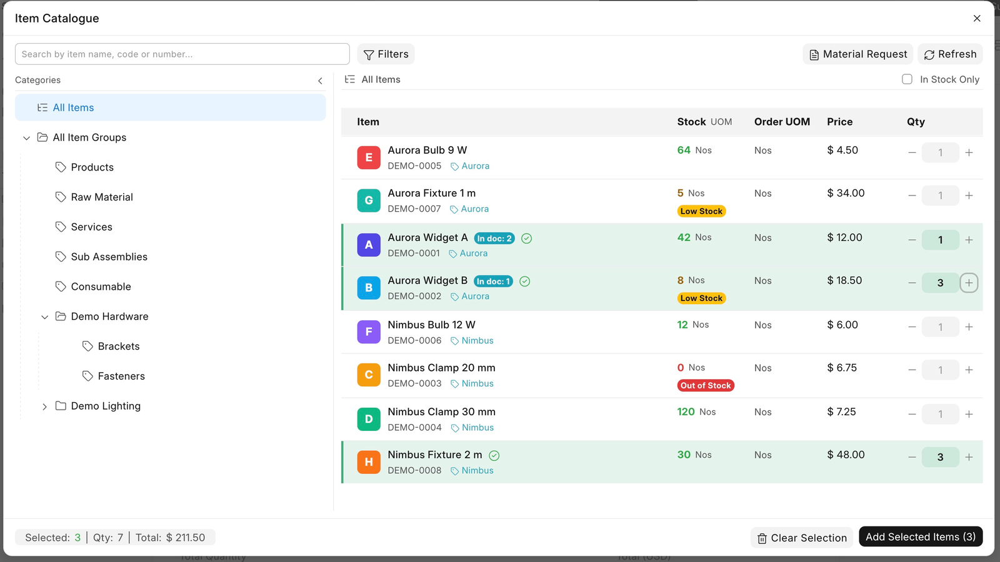
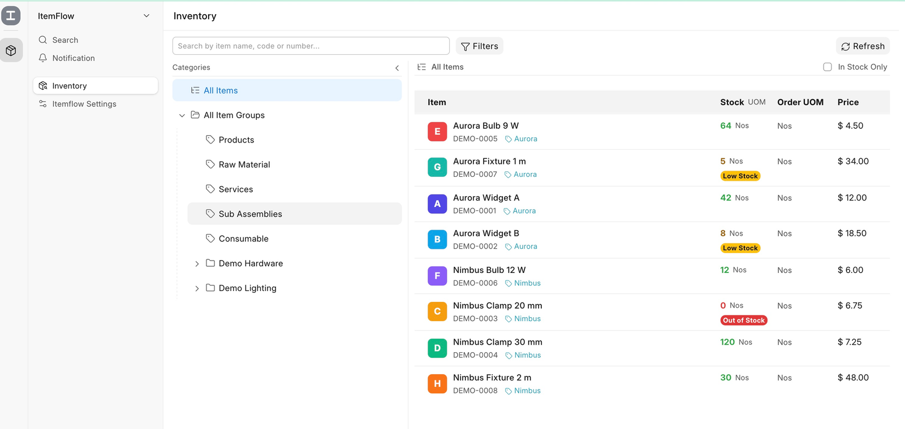
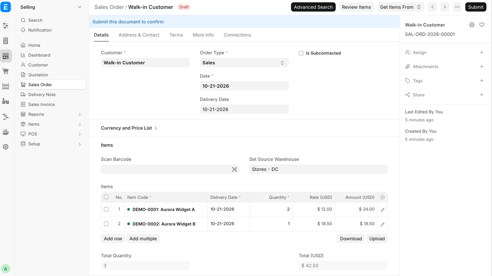

# ItemFlow

**A file-explorer-style item catalogue for ERPNext.**

[](LICENSE)
[](https://github.com/frappe/erpnext)
[](https://github.com/TheManuNext/itemflow-community/releases/tag/v2.8.1)



ItemFlow complements ERPNext's standard item selector with a two-pane catalogue:
an Item Group tree on the left and a searchable item list with stock, UOM and
pricing on the right. It adds an alternative way to find and add items from
supported documents, without replacing the standard selector or ERPNext's
business rules.

## Project status

ItemFlow is a personal, hobby project shared in case it is useful to the
Frappe/ERPNext community. It is not affiliated with or endorsed by Frappe
Technologies.

It is maintained as time allows. There is no roadmap, delivery schedule or
support commitment. Issues and pull requests are welcome, but review times may
vary.

## What it is and what it is not

**It is:**

- an additional item-selection interface for supported documents;
- a way to browse by Item Group and see stock, UOM and prices before adding items;
- configurable per site without code changes.

**It is not:**

- a replacement for ERPNext's standard item selector;
- a full inventory-management or stock-valuation screen;
- an official Frappe/ERPNext app;
- a supported product with an SLA.

|  |  |
|---|---|
| **Version** | 2.8.1 |
| **Frappe/ERPNext** | v16 (tested with 16.50 and 16.53/16.52; see [COMPATIBILITY](docs/COMPATIBILITY.md)) |
| **Licence** | GPLv3 |
| **Supported documents** | 9 doctypes |
| **Themes** | Light and dark |
| **Mobile** | Tested on iPhone 15 Pro Max (Safari and Brave) |

---

## Why ItemFlow exists

ItemFlow grew out of a practical problem: users who were new to ERPNext found the
standard item search too basic and too sparse. They could not see available
stock, could not easily distinguish between units of measure, and had no clear
view of what they had already selected.

The visual reference was the Windows File Explorer: a folder tree on the left,
the contents on the right. It is an interaction that feels familiar even to
someone who has never used an ERP before.

What began as a script became an app. It has been used daily in one small
business; that is one real-world use case, not a benchmark or a guarantee.

---

## Features

### Two-pane catalogue

- Item Group tree for browsing by category.
- Searchable item grid with stock, UOM and price visible before selection.
- Optional item images using the standard `Item.image` field.

### Search and filters

- Search by `item_code`, `item_name` or brand.
- Browse the Item Group tree and filter by Item Group, Brand and Stock UOM.
- N-gram search index for catalogues with long or non-Latin item names.
- Search index designed and tested for English and Thai item names, including
  non-Latin scripts.

### Stock, UOM and pricing

- Available stock from `Bin`, with a configurable low-stock warning.
- Standard price and multi-UOM support.
- Quantities and totals visible before adding lines to the document.

### Bulk selection

- Select multiple items with an individual quantity for each.
- Configurable maximum per operation (15 by default, 30 maximum).
- Running count of selected items and totals for the selection.
- Items already in the document are marked in the grid.

### Document integration

- Adds lines to sales, purchase and stock documents.
- Adds **Advanced Search** and **Review Items** buttons to supported documents.
- **Advanced Search** opens the two-pane catalogue from within the document,
  without switching to the standard item list.
- **Review Items** opens the items already in the document for review or editing.
- Required-field checks before the catalogue opens: Customer/Company,
  Supplier or Warehouse, depending on the doctype.

### Configuration without code

- Stock threshold, default quantity, batch size and maximum selection.
- Image visibility, brand column and visible filters.
- Default warehouse, button style and button position.
- Enabled doctypes.

### Themes and devices

- Supports Frappe's light and dark themes.
- Responsive layout: the category tree becomes a drawer on mobile and the item
  grid becomes stacked cards.
- Mobile layout tested on iPhone 15 Pro Max with Safari and Brave.

---

## Screenshots

Screenshots use demo data.

| Inventory page | Sales Order integration |
|---|---|
|  |  |

---

## Supported documents

- Sales Order
- Quotation
- Sales Invoice
- Purchase Order
- Material Request
- Supplier Quotation
- Purchase Invoice
- Purchase Receipt
- Stock Entry

---

## Community and private extensions

The public app is Community. It works with standard ERPNext fields and does not
require custom fields, private apps or external services beyond the standard
bench.

A private downstream app can add filters for custom `Item` fields through the
`itemflow_filter_fields` hook. That app is specific to one company, is not
required for Community, and is not published. See
[docs/EXTENDING.md](docs/EXTENDING.md).

Because ItemFlow is distributed under GPLv3, any distributed derived version
must comply with GPLv3. Internal use does not create that obligation.

---

## Requirements

- Frappe Framework / ERPNext **v16**.
- **Python 3.14** (required by Frappe v16; the app also uses Python 3.14 syntax).
- **Node.js 24** for `bench build`.
- MariaDB (tested with 11.8).
- A standard bench with Redis and workers as required by Frappe.

See [docs/COMPATIBILITY.md](docs/COMPATIBILITY.md) for the supported stack and
update policy.

---

## Installation

```bash
cd frappe-bench
bench get-app https://github.com/TheManuNext/itemflow-community.git --branch v2.8.1
bench --site your-site install-app itemflow
bench --site your-site migrate
bench build --app itemflow
bench restart
```

`install-app itemflow` installs ERPNext first if it is not already installed on
the site.

If you use a derived app, install it after ItemFlow. See
[docs/EXTENDING.md](docs/EXTENDING.md#deploying-a-derived-app).

---

## Configuration

All common settings live in **ItemFlow Settings**:

| Setting | What it controls | Default |
|---|---|---|
| `low_stock_threshold` | Stock warning threshold | 10 |
| `default_qty` | Default quantity per item | 1 |
| `max_items` | Maximum items per operation (30 maximum) | 15 |
| `add_chunk_size` | Items added per batch | 10 |
| `show_item_images` | Show `Item.image` | On |
| `show_brand` | Show the brand in the grid | On |
| `default_warehouse` | Warehouse used for stock | Empty |
| `show_filter_brand` | Show the Brand filter | On |
| `show_filter_stock_uom` | Show the Stock UOM filter | On |
| `enable_<doctype>` | Enable the catalogue per document type | Per doctype |
| `button_style`, `check_order_button_style` | Button appearance | primary / secondary |
| `button_position` | Button position in the form | top |

Required-field checks depend on the doctype and are not configurable: Sales
Order and Sales Invoice require Customer and Company; Quotation requires Party
and Company; purchasing documents require Supplier and Company; Stock Entry
requires Company and a target Warehouse.

---

## Compatibility and known limitations

- Tested with Frappe/ERPNext v16. Backend, API and boot were verified on Frappe
  16.53.0 / ERPNext 16.52.1; the UI was smoke-tested on Frappe 16.50.0. See
  [docs/COMPATIBILITY.md](docs/COMPATIBILITY.md).
- Tested with catalogues of up to **1,500 items**. Catalogues of **2,000+** have
  not been tested.
- Supports Frappe's light and dark themes.
- Tested on desktop and on iPhone 15 Pro Max with Safari and Brave. Other mobile
  browsers and devices are expected to work but have not been tested.
- Search tested with English and Thai item names. The interface is in English.
- ItemFlow is a search and selection layer. It does not replace the standard
  item selector, the Item doctype or ERPNext's business rules.
- Performance depends on permissions and on the volume of `Bin` and `Item Price`
  records on each site.
- The interface is not a full inventory-management screen. The read-only
  Inventory page is intended for quick consultation.

---

## Background

ItemFlow started as a practical solution for one small business. I work with ERP
systems from the user side rather than as a professional software developer, and
that perspective shaped the design.

The code was developed with AI assistance under human direction. It has been used
daily in one small business; that is one real-world use case, not a benchmark or
a guarantee.

---

## Contributing

Issues and pull requests are welcome. There is no guarantee of response or fix,
but useful reports are read.

Useful reports include:

- Frappe/ERPNext and ItemFlow versions
- The doctype where the problem occurs
- Steps to reproduce it
- Screenshots and console errors

See [CONTRIBUTING.md](CONTRIBUTING.md) for the full guide.

---

## Licence

GPLv3. See [LICENSE](LICENSE).

Copyright © 2025–2026 TheManuNext.

ItemFlow includes adapted code from ERPNext, which is also distributed under
GPLv3. Portions of the code are adapted from ERPNext, © Frappe Technologies
Pvt. Ltd. and Contributors, and are used under GPLv3. The adapted files retain
their original copyright and licence notices.
